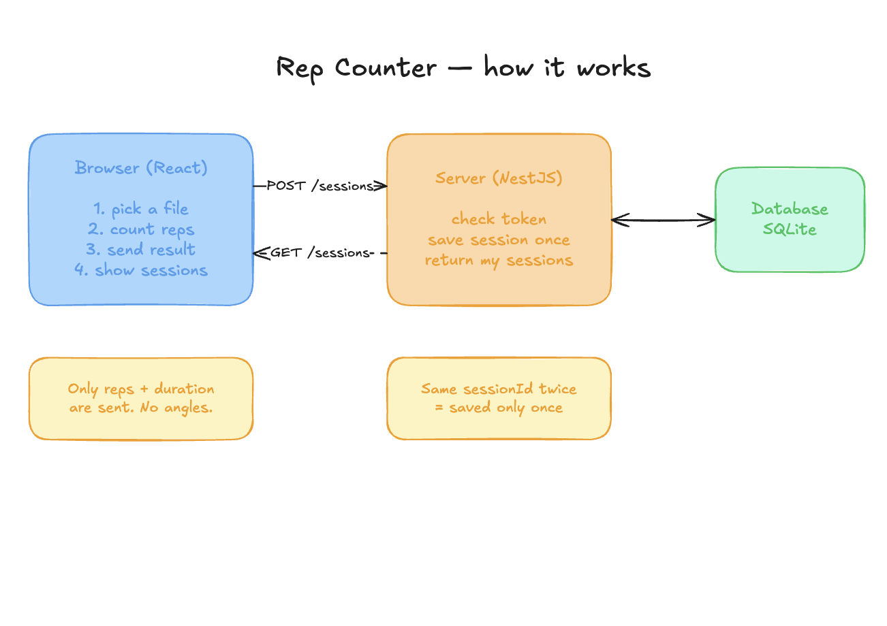
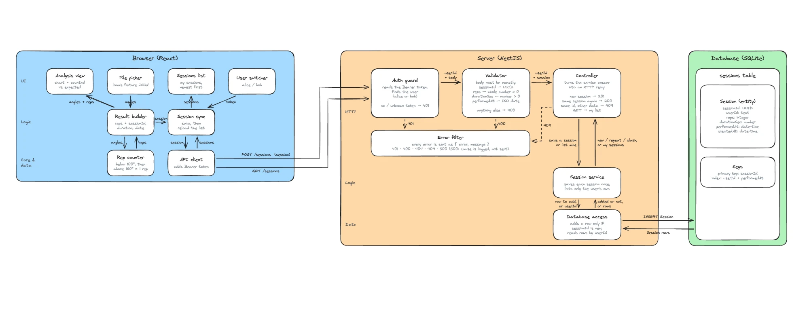

# rep-counter

Counts squats from knee angles in the browser, saves only the result to a NestJS API, lists each user's sessions.

## Run

One command, no Node needed:

```bash
docker compose up --build      # http://localhost:8080
```

Or with Node 22:

```bash
npm install
npm run dev                    # http://localhost:5173 (API on :3000)
npm test                       # 77 tests: core, api, web
```

Pick **alice** or **bob** in the top right, pick a fixture, press **Save session**. Press it again: the server answers 200 and keeps one copy.

| Env | Default |
|---|---|
| `API_PORT` | `3000` |
| `DB_PATH` | `apps/api/data/rep-counter.sqlite` (Docker: volume `/data`) |
| `AUTH_TOKENS` | `alice-token:alice,bob-token:bob` |

## Personal feedback

I started the implementation by following the simple plan I saw from ThePrimeagen in one of his recent videos. Here's the link with the exact timecode: https://youtu.be/FlWII9xFabo?si=lMTWN4GD2aPXXSr_&t=632

So with that idea in mind, I actually put 80% of the effort into imagining and planning the system first. I probably did around 15+ cycles of refining the system design before pushing into the actual materialization of the idea.

I also picked technologies and tools that are new to me and that I never really used, like Drizzle and the SQLite database. But I decided to use at least one I love right now, which is Nest.
(Shout-out to Kamil Myśliwiec for bringing my current favorite framework to life.)

And about the thing AI got wrong: for me, it was the system design. The initial version was a nightmare; I've attached it below.



I also decided to raw-dog it in terms of CLAUDE.md instructions. Plan mode with a list of directions like plan → architecture design → interface design → initial version → refining each part of the system was enough for this.

What would I do beyond the AI-selected "What's next" points?

UI redesign. It's ugly. With extra time spent, it can be a piece of candy.

## System design



Editable source: [`docs/design.excalidraw`](docs/design.excalidraw).

## How it works

In short:

- **Browser** reads the fixture, counts reps (`packages/core`), builds `{ sessionId, reps, durationSec, performedAt }` and sends only that. The API client re-parses with a strict schema, so angles can't be sent even by mistake.
- **Server**: token guard (401) → strict validator (400, rejects `angles`) → controller → service → store. The `sessionId` primary key decides first save (201) vs repeat (200); same id with other data or another user is 409.
- **Rep rule**: below 100° for 3 frames in a row, then above 160° for 3 frames = 1 rep. Fixtures: 10 / 8 / 7.

Docs, short: [requirements](docs/01-requirements.md) · [architecture](docs/02-architecture.md) · [contracts](docs/03-contracts.md) · [interfaces](docs/04-interfaces.md). Agent rules: [`CLAUDE.md`](CLAUDE.md).

## Assumptions

- **Thresholds are strict**: 100° and 160° exactly don't count as past the line.
- **3-frame streak** (100 ms at 30 Hz) filters one-frame glitches. A plain two-threshold counter already gives 10 / 8 / 7, so this is a safety margin, not a fit to the data.
- **Dropped frames** (`null`) break a streak and never count.
- **A recording that starts in the squat** counts its first rep once the user stands up.
- **`sessionId`** is a UUID made once per analysis, so a retry reuses it. Not a hash of the file: two real sessions with identical data are still two sessions.
- **`durationSec`** = frames ÷ sample rate. **`performedAt`** = time of analysis, because fixtures carry no recording time.
- **"Same data"** compares `performedAt` as an instant: `12:00+02:00` equals `10:00Z`.
- **409 for another user's id** reveals that the id exists. Accepted: ids are random UUIDs and the brief asks for 409.

## Another thing the AI got wrong (agent's note)

The agent wrote `data/` in `.gitignore` to keep the SQLite file out of git. That rule also matched `apps/web/src/data/`, the folder holding the API client. The commit went in without it, so the app could not build from a clean checkout.

I noticed because the list of files in the commit had no `apiClient.ts`. The fix was to narrow the rule to `apps/api/data/`. A fresh clone with `npm ci && npm test` is now part of checking every commit.

It happened again later: `**/data` in `.dockerignore` broke the Docker build the same way. That time the build caught it at once.

## What's next

- **Retry and offline queue** in the browser. The id is already made once per analysis, so resending is safe; it just needs a queue and backoff.
- **Pagination** on `GET /sessions`. The response is already `{ items }`, so adding a cursor isn't a breaking change.
- **Real login** (JWT/OAuth). Auth is one guard plus a token map; replace the guard.
- **Postgres**: the store is an async interface; add a second implementation. Then the concurrency test covers truly parallel writes too: SQLite's driver handles one request at a time, so the test proves the logic, not parallel safety.
- **Migrations** with drizzle-kit. Today the table is defined twice, once in SQL and once in Drizzle.
- **Browser end-to-end test** (Playwright) for the full flow through Docker.
- **Smaller API image** (427 MB now): bundle the API and drop the build-only parts of `node_modules`.
